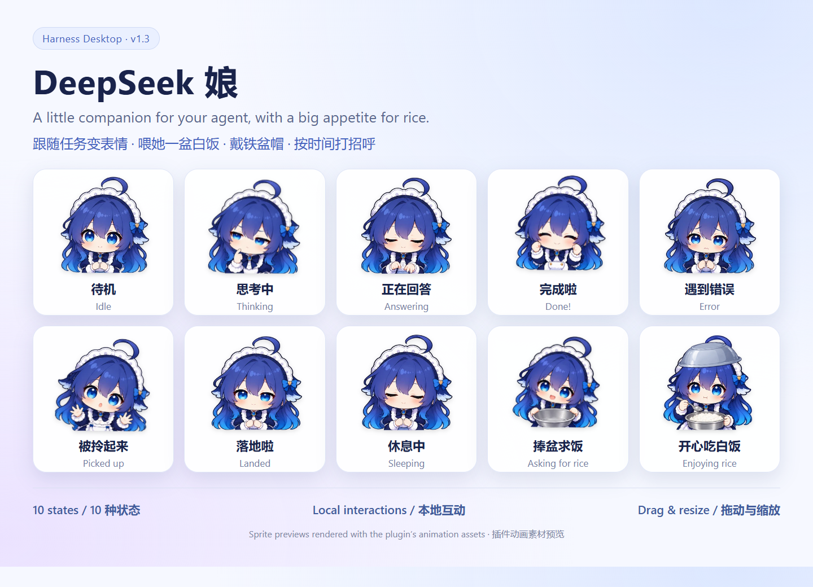
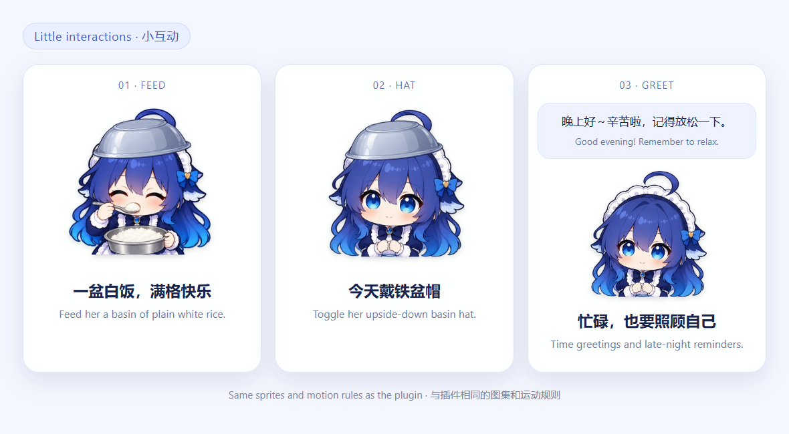
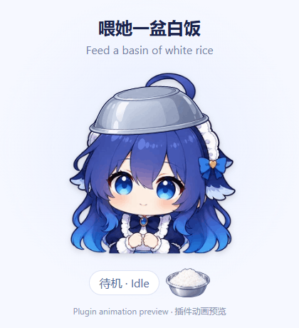

# DeepSeek Girl · Harness Desktop

**A little companion who thinks with you, writes with you, and waits for rice with an iron basin.**

English · [中文](README.md) · **v1.3.0** · [Download](https://github.com/nailiang002-wq/deepseek-girl-harness/releases/tag/v1.3.0)



DeepSeek Girl is an interactive character plugin for **DeepSeek Harness Desktop**. She changes expressions with your current task. Pick her up, move her around the window, feed her plain white rice, or let her wear an upside-down iron basin as a hat. Time-based speech bubbles bring a small greeting to your day.

She lives inside the Harness window. Animations and interactions run locally, with no extra model calls.

## Image and animation demos



<p align="center"></p>

These previews use the same sprite atlases and motion rules as the plugin. They contain no personal conversations. Six key poses per state are combined with continuous breathing, swaying, and a soft landing.

## What she does

| Feature | Behavior |
| --- | --- |
| Task expressions | Thinks during reasoning, types while the answer streams, celebrates completion, and looks upset after an error |
| White-rice feeding | Click the rice-filled iron basin; she happily scoops and chews, then returns to the current task after about four seconds |
| Asking for rice | Holds out an empty basin while idle; feeding pauses requests for two minutes |
| Basin hat | Toggle an upside-down silver basin that moves with her |
| Pick up and drop | Gently swings while dragged and settles when released; remembers her position |
| Time greetings | Greets you using your computer’s local time and reminds you to rest late at night |
| Sleep | Rests after 90 seconds without input and wakes on mouse or keyboard activity |
| Animation controls | Preview expressions, pause motion, respect reduced-motion settings, and pause visual playback while the window is hidden |

There are **10 states**: idle, thinking, answering, success, error, dragging, landing, sleeping, asking for rice, and eating rice. Stopping a task or waiting for approval is not treated as successful completion.

## Install

1. Download `DeepSeekGirl-Harness-v1.3.0.zip` from [Releases](https://github.com/nailiang002-wq/deepseek-girl-harness/releases/tag/v1.3.0) and extract it.
2. In Harness, open **Plugins → Add plugin**.
3. Enter the full path to the extracted `DshDeepSeekGirl` folder, install it, and enable it.
4. Reload the interface when prompted. If your version has no reload option, quit and reopen Harness.

Alternatively, download or clone this repository and add its root folder—the one containing `package.json`—as a plugin. **The prebuilt plugin does not require Node.js or a build step.**

Tested on DeepSeek Harness Desktop for Windows. Other operating systems have not been tested. The plugin uses Harness’s Cordis interface and its built-in conversation and chat services.

## Controls

| Action | Result |
| --- | --- |
| Drag the character | Move her |
| Ctrl + mouse wheel | Resize her |
| Click or right-click the character | Open expressions and interactions |
| Click the rice basin | Feed her |
| Menu: Wear / Remove basin hat | Toggle the hat |
| Menu: Say hello | Show the current time greeting manually |
| Menu: Disable time greetings / idle rice requests | Turn off an automatic interaction |
| Menu: Pause animation | Stop pose playback and continuous motion |

Position, size, hat, and interaction preferences are stored locally. Disable or uninstall the plugin from the Harness plugin list.

## Time greetings

| Local time | Greeting |
| --- | --- |
| 05:00–10:59 | Good morning! Let’s make it a lovely day. |
| 11:00–13:59 | Good afternoon! Remember lunch. I’d love a basin of rice, too! |
| 14:00–17:59 | Hello! Take a moment to rest and have some water. |
| 18:00–22:59 | Good evening! You’ve worked hard. Remember to relax. |
| 23:00–04:59 the next day | It’s getting late. Take care of yourself and get some rest. |

Automatic greetings appear once per time period, including after a conversation switch or app restart. The hours before and after midnight share one late-night period. Greetings wait until she is idle if you are working, feeding her, dragging, previewing a state, or using the menu. Bubbles disappear after about ten seconds and have a close button.

## Animation and local behavior

Version 1.3 replaces timer-driven image changes with predecoded transparent sprite atlases played by the browser. Continuous breathing and swaying do not rerender the whole character every frame. Drag updates are coalesced with the display refresh cycle. Expressions and hand gestures still use six original key poses; this is not a newly drawn animation frame for every display frame.

The plugin observes task state without rewriting conversation content, sending external telemetry, or making extra model calls for feeding and greetings.

## Development

Use Node.js 20 or newer. Source frames, the client template, and tests are included.

```sh
npm install
npm run build
npm test
```

Optional checks in a real browser:

```sh
npx playwright install chromium
npm run test:browser
```

`client.template.js` is the editable client template. `scripts/build.cjs` embeds `assets/frames` and `assets/props` into `client.js`. `logic.js` contains state and time rules; `projection.js` distinguishes completion, failure, and stopping. Temporary test files go into `.cache/`.

Browser checks cover all ten atlases, loop and one-shot endings, meal restarts, the hat, pause, reduced motion, hidden-window playback, and saved drag positions. In a standalone test page, about three seconds of looping playback reduced character component renders from ten in the earlier version to zero in this version. This is not a fixed frame-rate guarantee for every machine or application load.

## Artwork

This is an unofficial character plugin, with no affiliation to DeepSeek. Illustrations were generated with ImageGen from a character reference supplied by the project creator. Prompts are in [assets/generation-prompts.txt](assets/generation-prompts.txt). The original reference image is not included.
