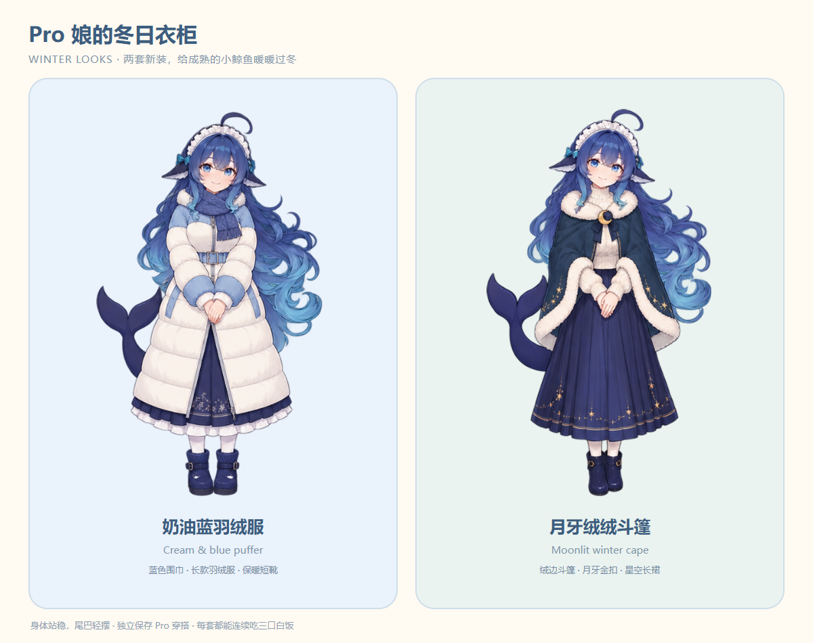
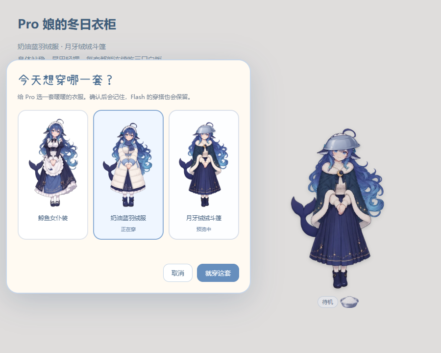
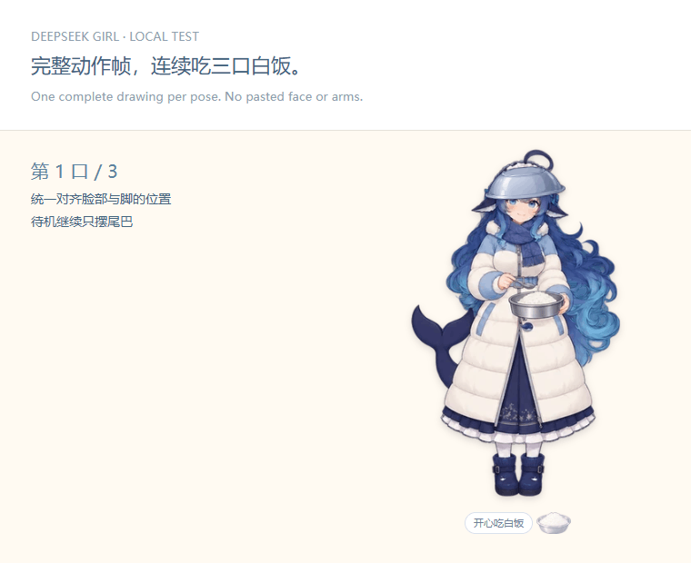
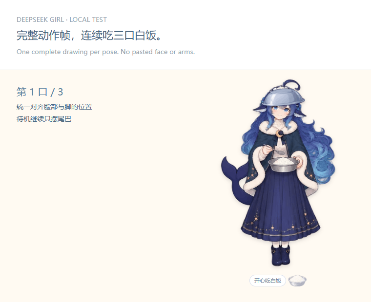
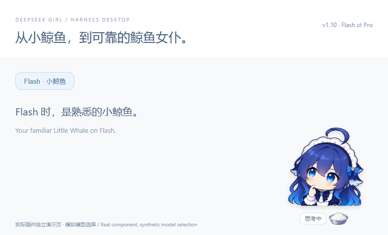
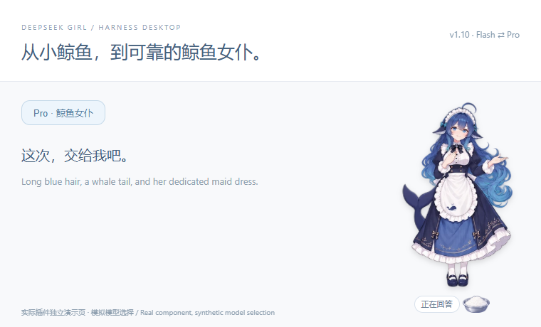
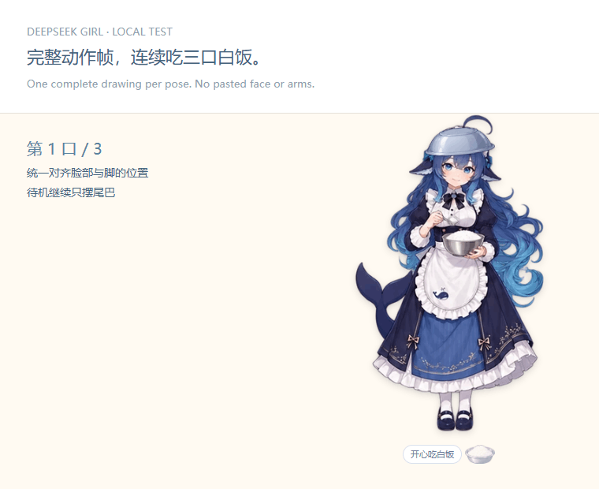

# DeepSeek Girl · Harness Desktop

**Switch to Pro and watch Little Whale transform. Switch back to Flash to welcome her back in her saved outfit.**

English · [中文](README.md) · **v1.11.0**

## A winter wardrobe for Pro

Pro can now preview and save a **Cream & blue puffer** or **Moonlit winter cape**, alongside her original whale-maid dress. In Pro form, click her body and open the wardrobe. Cancel restores the saved outfit; confirm remembers it across transformations and reloads. Flash retains its separate five-outfit wardrobe.



Both outfits cover all twelve states. Idle and expression poses keep the body still with a gently moving tail. Feeding uses twelve complete character drawings for three consecutive bites. Hat placement follows each pose, and changing clothes during a meal preserves elapsed progress. Winter transformations use the existing water effect and whole-character fades with the saved outfit. Non-feeding states use complete still poses and tail motion rather than face or arm overlays. The new outfits add 48 independent character drawings; see [sources and prompts](assets/forms/pro/outfits).



<details>
<summary>Watch both winter outfits eat three consecutive bites</summary>

<p align="center"></p>
<p align="center"></p>

</details>

The winter artwork, wardrobe screenshot and feeding GIFs use the real plugin in a standalone test page, without personal conversations or real account data.

<p align="center"></p>

<p align="center"><a href="https://github.com/nailiang002-wq/deepseek-girl-harness/releases/latest/download/DeepSeekGirl-Harness.zip"><strong>⬇ Download the latest plugin (ZIP)</strong></a> · <a href="#install-in-three-steps">Install in three steps</a> · <a href="https://github.com/nailiang002-wq/deepseek-girl-harness/issues">Report a problem / Suggest an interaction</a></p>

**For DeepSeek Harness Desktop; tested on Windows.** This is an unofficial character plugin that lives inside the Harness window. The prebuilt download needs no Node.js, and animations and interactions require no extra model calls.

The opening GIF uses the real plugin with synthetic model selections and tasks. The earlier interaction demo also uses synthetic financial data. Wheel and installation screenshots below come from Harness itself.

## Change the model, watch her transform

Select **DeepSeek Pro** in the current conversation to trigger a **2.2-second** water-wave transformation into a mature whale maid. Select **Flash** to bring Little Whale back with her saved outfit. The animation starts after a successful selection, **without sending a message** or making an extra model call.

The transformation unfolds in three stages:

1. **Water and light gather**: a pale blue glow surrounds her as water rings and droplets rise. A handwritten caption announces the change.
2. **The new form appears**: Little Whale fades out and the long-haired whale maid emerges through the water effect, with blue hair and pale tips, a curved ahoge, a whale tail, a white whale-emblem apron, and a navy dress.
3. **She returns to your task**: the glow clears and she follows thinking, answering, completion, and the other task states. Her body stays steady while her tail sways gently. Feeding uses complete character drawings for three consecutive bites.

The transition works **in both directions**. Pro → Flash plays the return animation and restores Little Whale's saved outfit. Harness's successful model selection triggers it automatically; there is no separate transform button. Startup and conversation changes show the matching form directly.



- **A dedicated Pro dress**: long blue hair, blue eyes, a curved ahoge, a whale tail, and a white apron, with all twelve states.
- **A steady body, a gentle tail**: Pro's idle and expression poses use a fixed body with a separate tail layer. Feeding plays three bites using complete drawings registered at the face and shoes, avoiding mismatched face or arm overlays.
- **The familiar interactions**: three bites of rice, head pats, pouting, a basin hat, dragging, greetings, and the ledger. Head targets and hat placement follow the mature proportions.
- **Considerate transitions**: startup and conversation changes show the corresponding form directly. Rapid selections use the last successful choice; eating, dragging, and open wardrobe actions finish before the visual transition.
- **Separate outfit memory**: Flash retains five outfits. Pro offers her maid dress and two winter outfits. Each form previews and remembers its own clothes.
- Paused animations, system reduced motion, and hidden windows switch directly. Official DeepSeek Pro model IDs are recognized; other models use Little Whale.

v1.10 uses Harness's model-selection service, verified on Windows with bundled SDK **0.2.1-rc.2**. Upgrade Harness if an older release lacks that service. The earlier [wheel, head-pat, and rice demo](docs/images/quick-tour.gif) remains available.

<p align="center"></p>

The familiar daily interactions remain: asking for rice, head pats and pouting, a basin hat, handwritten time greetings, a compact action wheel, and a brief balance-and-usage peek after a head pat. Flash retains five complete interactive outfits.

## Install in three steps

**Download the plugin ZIP, rather than GitHub’s “Source code”. Extract and keep the entire folder.**

1. **Download and extract** the ZIP above; find the `DshDeepSeekGirl` folder.
2. In Harness, open **Plugins → Add plugin** (choose **Install third-party plugin** if a dropdown appears). Paste the full path of the `DshDeepSeekGirl` folder containing `package.json` into **Package name or address**.
3. **Install and enable** the plugin, then reload when prompted. If your version has no reload option, quit and reopen Harness.

For example, enter `D:\Plugins\DshDeepSeekGirl`, pointing to this folder rather than the ZIP or its parent:

```text
DshDeepSeekGirl/
├─ package.json   ← Choose the folder containing this file
├─ index.js
└─ client.js
```


Updating: keep your extracted plugin folder. Replace its files with the new version and reload. If Harness requires a reinstall, uninstall the old plugin from the list, then add the new folder.

Tap her head for a gentle pat; three quick taps make her pout. Click her body or right-click for the menu. Feed her using the rice basin, drag to move, or use Ctrl + mouse wheel to resize.

If installation fails, open an [issue](https://github.com/nailiang002-wq/deepseek-girl-harness/issues) with your Harness version, operating system, and error message. Feedback about favorite motions, stuttering, and future interactions is welcome.

**Trying it for the first time?** We are looking for five Windows or Mac volunteers to try installing, changing outfits and feeding rice. [Share what worked and where you got stuck](https://github.com/nailiang002-wq/deepseek-girl-harness/issues/new?template=first-try.md). Mac support still needs real-device testing.

## A smaller wheel, closer interactions

Click her body or right-click to open six frequent actions: rice, head pats, outfits, hat, greetings, and More. Cream paper, blue doodles, and bundled handwriting replace the tall menu.


- **More → Expressions**: twelve previews across two pages.
- **More → Settings**: toggle rice requests, greetings, and the head-pat ledger.
- **More → Ledger**: open details whenever you like.
- Use the center button or Esc to close; arrow keys and edge-aware positioning are supported.

## Image and animation demos


<p align="center"></p>

These previews use the plugin's artwork without personal conversations. Flash has 390 source poses, Pro's maid dress has 90, and the winter outfits add 48, for 528 in total. A meal plays its twelve-pose bite three times, for 36 pose visits. Pro's non-feeding states keep the body still with a separate tail animation.

## What she does

| Feature | Behavior |
| --- | --- |
| Flash ⇄ Pro | A successful model selection triggers the transformation; Flash restores the saved outfit |
| Task expressions | Thinks during reasoning, types while the answer streams, celebrates completion, and looks upset after an error |
| Wardrobe | Classic maid, blue & white hoodie, star pajamas, cream & blue puffer, and moonlit winter cape; preview first, then confirm to save |
| White-rice feeding | Three full bites with scooping, lifting the spoon, chewing, and a satisfied smile; returns to the current task after about 13 seconds |
| Head pats | Tap her head to see her close her eyes and nuzzle, with little floating hearts; also available in the menu |
| Repeated taps | Three quick head taps trigger a brief playful pout, returning after about 1.8 seconds; head pats do not interrupt a meal |
| Asking for rice | Holds out an empty basin while idle; feeding pauses requests for two minutes |
| Basin hat | Toggle an upside-down silver basin that moves with her |
| Pick up and drop | Gently swings while dragged and settles when released; remembers her position |
| Time greetings | Greets you using your computer’s local time and reminds you to rest late at night |
| Sleep | Rests after 90 seconds without input and wakes on mouse or keyboard activity |
| Animation controls | Preview expressions, pause motion, respect reduced-motion settings, and pause visual playback while the window is hidden |

There are **12 states**: idle, thinking, answering, success, error, dragging, landing, sleeping, asking for rice, eating rice, enjoying head pats, and pouting. Stopping a task or waiting for approval is not treated as successful completion.

## Other installation options and compatibility

Alternatively, download or clone this repository and add its root folder—the one containing `package.json`—as a plugin. **The prebuilt plugin does not require Node.js or a build step.**

Tested on DeepSeek Harness Desktop for Windows. Other operating systems have not been tested. The plugin uses Harness’s Cordis interface and its built-in conversation and chat services.

## Controls

| Action | Result |
| --- | --- |
| Drag the character | Move her |
| Ctrl + mouse wheel | Resize her |
| Tap her head | Pet her; three quick taps make her pout |
| Click her body / Right-click / Enter or Space | Open the action wheel |
| Click the rice basin | Feed her |
| Menu: Open wardrobe | Preview, apply, or cancel an outfit change |
| Menu: Wear / Remove basin hat | Toggle the hat |
| Menu: Say hello | Show the current time greeting manually |
| Wheel: More → Settings | Toggle greetings, rice requests and the pat-to-peek ledger |
| Wheel: More → Pause | Stop pose playback and continuous motion |

Outfit, position, size, hat, and interaction preferences are stored locally. Disable or uninstall the plugin from the Harness plugin list.

## A small wardrobe


**Winter additions:** A cream and blue quilted puffer with a knitted blue scarf, and a teal winter cape with ivory fur trim, a gold crescent clasp, and a cream turtleneck. Both cover all twelve states and retain the basin hat and three-bite feeding animation.


Open the character menu and choose **Open wardrobe**. Select an outfit to preview it, then choose **Wear this outfit** to remember it. Cancel, Escape, or clicking outside restores the saved outfit. The selected card also shows a live preview when the panel covers the character.

All five outfits cover thinking, answering, feeding, head pats, pouting, dragging, sleeping, and the other states. Changing clothes preserves the current task and meal progress, along with the basin hat and character position. The twelve meal poses now play three complete bites instead of stopping after one.

## Her little rice-money ledger

**A head pat, a little peek at today.** The card stays hidden at rest. Pat her head to show your balance, estimated cost and tokens for about ten seconds. Hover or focus the card to keep it readable; click for details. **More → Ledger** opens details directly.

Toggle this interaction under **More → Settings → Pat to peek**. Queries run only while the card or details are open, with at most one automatic refresh per minute. Money values stay in memory; only the feature toggle is saved locally.


**The image uses synthetic example values, not a real account.**

- **Balance** comes from the account signed in to Harness, including recharge and bonus wallets. CNY and USD remain separate. This account may differ from the owner of a configured API key; API-key and third-party account balances are not queried by this release.
- **Today's Tokens** come from provider-reported usage in this local Harness profile's durable session records. The local calendar day is used. Forked inherited history is excluded; retries count separately and final samples replace earlier samples from the same attempt. Reloads derive the totals again from the logs.
- **Estimated today** uses known official DeepSeek model rates and reported uncached input, cache reads, and output. It shows an off-peak-to-peak **CNY range**, with pricing checked on 2026-10-16. It is not the account's settled bill, and does not include other devices or services. [Official pricing](https://api-docs.deepseek.com/quick_start/pricing/) and the panel's official-bill link let you check the source and actual spending.
- Missing usage, unsupported models/providers, and insufficient cache evidence are disclosed. Title/search requests without reported Tokens count as coverage gaps. Missing totals show **—**; login, network, and scan failures are distinct from a confirmed zero. A failed session scan never becomes a zero daily total.

The feature uses the existing authenticated Harness Remote APIs. It does not ask for an API key or send chat text to a new service. Polling stops when hidden or disabled. Balances are cleared after sign-out.

## Time greetings

**Version 1.4 adds handwriting and a crayon-note greeting bubble**: cream paper, blue hand-drawn double lines, a small star, and pale peach doodles. The font is bundled for offline use. Placement follows the measured text height, with wrapping and viewport-edge handling, including dark backgrounds and reduced motion.


These previews show the actual client in a standalone test page.

| Local time | Greeting |
| --- | --- |
| 05:00–10:59 | Good morning! Let’s make it a lovely day. |
| 11:00–13:59 | Good afternoon! Remember lunch. I’d love a basin of rice, too! |
| 14:00–17:59 | Hello! Take a moment to rest and have some water. |
| 18:00–22:59 | Good evening! You’ve worked hard. Remember to relax. |
| 23:00–04:59 the next day | It’s getting late. Take care of yourself and get some rest. |

Automatic greetings appear once per time period, including after a conversation switch or app restart. The hours before and after midnight share one late-night period. Greetings wait until she is idle if you are working, feeding her, petting her, triggering a pout, dragging, previewing a state, or using the menu. Bubbles disappear after about ten seconds and have a close button.

## Animation and local behavior

Version 1.3 replaces timer-driven image changes with predecoded transparent sprite atlases played by the browser. Continuous breathing and swaying do not rerender the whole character every frame. Drag updates are coalesced with the display refresh cycle. Version 1.6 reuses twelve meal poses across three bites and supplies every state in all three outfits. Decoded atlas caching is bounded, and switching outfits preserves the elapsed time of one-shot reactions. These are not newly drawn illustrations for every display refresh.

The plugin observes task state without rewriting conversation content, sending external telemetry, or making extra model calls for feeding and greetings.

## Development

Use Node.js 20 or newer. Source frames, the client template, and tests are included.

```sh
npm install
npm run build
npm test
```

Optional checks in a real browser:

```sh
npx playwright install chromium
npm run test:browser
```

For the native connection regression, point `DSG_HARNESS_NODE_MODULES` at Harness's `node_modules` directory and run `npm run test:native`. It uses native Cordis, Typert, and Client Gateway with synthetic sessions to verify the complete usage path. It does not read personal profiles or real conversations, or make network requests.

`client.template.js` is the editable client template. `scripts/build.cjs` embeds `assets/frames`, `assets/outfits`, `assets/forms/pro`, and `assets/props` into `client.js`. `logic.js` contains state and time rules; `projection.js` distinguishes completion, failure, and stopping. Temporary test files go into `.cache/`.

Browser checks cover all 60 outfit/state atlases, wardrobe preview/apply/cancel and saved reloads, three-bite meal timing, switching outfits during a meal, loop and one-shot endings, meal restarts, head/body taps, repeated taps, touch input, keyboard menus, the hat, pause, reduced motion, hidden-window playback, and saved drag positions. In a standalone test page, about three seconds of looping playback reduced character component renders from ten in the earlier version to zero in this version. This is not a fixed frame-rate guarantee for every machine or application load.

## Artwork

Pro artwork was generated with built-in ImageGen from the new character reference. Transparent source frames, selected sheets, and full prompts are in [assets/forms/pro](assets/forms/pro). Sources are aligned at 512×768 and compiled into 320×480 transparent runtime atlases. The reference itself is not redistributed.

This is an unofficial character plugin, with no affiliation to DeepSeek. Illustrations were generated with ImageGen from a character reference supplied by the project creator. Original prompts are in [assets/generation-prompts.txt](assets/generation-prompts.txt), and the new v1.5 art prompts are in [assets/v1.5-generation-prompts.txt](assets/v1.5-generation-prompts.txt). Wardrobe prompts and selected source sheets are in [assets/outfits](assets/outfits). The original reference image is not included.

The greeting font is a renamed subset of [Xiaolai v3.126](https://github.com/lxgw/kose-font), distributed as DSG Greeting Hand under SIL Open Font License 1.1. See [assets/fonts](assets/fonts) for the license and provenance. This is the font’s license, not a license for the entire plugin or character artwork.
