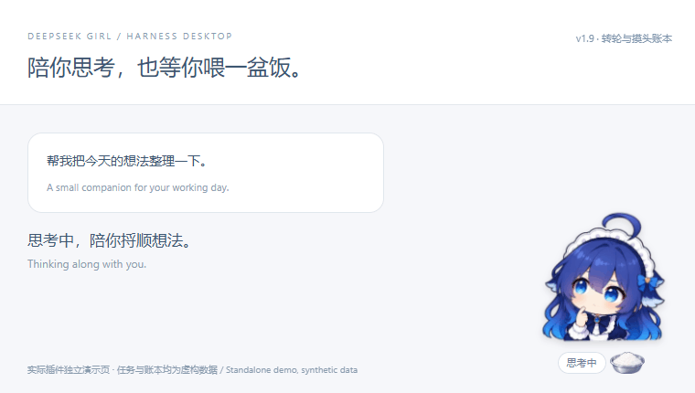
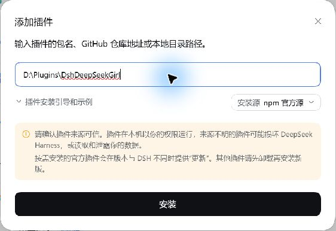
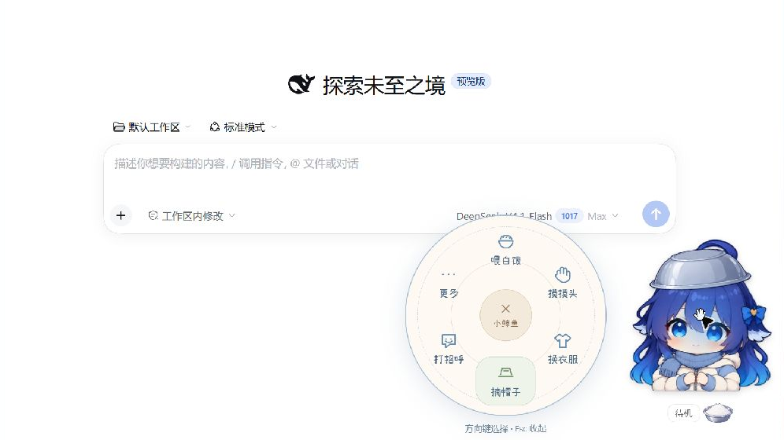

# DeepSeek 娘 · Harness Desktop

**让 DeepSeek 娘住进 Harness：陪你思考，捧盆求饭，吃饱后开心地晃一晃。**

[English](README.en.md) · 中文 · **v1.9.0**

<p align="center"></p>

<p align="center"><a href="https://github.com/nailiang002-wq/deepseek-girl-harness/releases/latest/download/DeepSeekGirl-Harness.zip"><strong>⬇ 下载最新版插件（ZIP）</strong></a> · <a href="#三步安装">三步安装</a> · <a href="https://github.com/nailiang002-wq/deepseek-girl-harness/issues">反馈问题 / 提建议</a></p>

**适用于 DeepSeek Harness Desktop，已在 Windows 验证。** 非官方角色插件；角色显示在 Harness 窗口内。使用预编译安装包无需 Node.js，互动和动画无需额外模型调用。

DeepSeek 娘是为 **DeepSeek Harness Desktop** 制作的互动角色插件。她会跟随当前任务改变表情，你也可以把她拎到窗口另一边、喂她一盆白饭，或给她戴上铁盆帽。早晨、午间和夜晚，她会用小气泡跟你打招呼。点一下身体就能打开紧凑转轮，常用互动就在手边。摸摸头后，余额与今日用量短暂出现。衣柜共有五套完整服装，每套都能连续吃三口白饭。

首页动图使用实际插件界面与虚构任务、账本数据；下方转轮与安装窗口图来自 Harness 实机。

## 三步安装

**下载的是插件 ZIP，不要选择 GitHub 的 “Source code”。解压后保留整个文件夹，不要只取 `client.js`。**

1. **下载并解压**上面的 ZIP，找到 `DshDeepSeekGirl` 文件夹。
2. 在 Harness 左侧打开 **插件 → 添加插件**；有下拉选项时选 **安装第三方插件**。把包含 `package.json` 的 `DshDeepSeekGirl` 文件夹完整路径粘贴到“包名或地址”。
3. **安装并启用**，按提示重新载入界面；没有重新载入入口时，退出并重新打开 Harness。

例如解压后的目录是 `D:\Plugins\DshDeepSeekGirl`，就填写这个路径，不要填写 ZIP 的路径或更外层目录：

```text
DshDeepSeekGirl/
├─ package.json   ← 这个文件所在的文件夹
├─ index.js
└─ client.js
```



已有旧版：先保留解压目录。可把新版文件覆盖到原来的插件目录并重新载入；若 Harness 提示需要重新安装，请先在插件列表卸载旧版，再添加新版目录。

第一次使用：轻点头部摸摸头，快速点三次会鼓脸；点击身体或右键打开菜单。点击旁边的白饭盆喂饭，按住角色拖动，Ctrl + 滚轮调整大小。

遇到安装问题，请到 [Issues](https://github.com/nailiang002-wq/deepseek-girl-harness/issues) 告诉我你的 Harness 版本、系统和报错内容。也欢迎反馈最喜欢的动作、哪里卡顿或下一步想加入的互动。

**第一次体验？** 正在找 5 位 Windows / Mac 用户试试“安装 → 换装 → 喂饭”，欢迎[留下哪里顺手、哪里卡住](https://github.com/nailiang002-wq/deepseek-girl-harness/issues/new?template=first-try.md)。Mac 仍需要真机验证。

## 转轮更小，互动更近

点击身体或右键角色，六个常用入口围成一个小转轮：喂饭、摸头、换装、帽子、问候、更多。奶油色底、蓝色小涂鸦和离线手写字体；原来整页的选项放到第二层。



- **更多 → 表情预览**：十二种表情，分两页。
- **更多 → 小设置**：开关求饭、时间问候、摸头账本。
- **更多 → 小账本**：随时主动查看明细。
- 点击中央或按 Esc 收起；支持方向键和窗口边缘避让。

## 图片与动画演示


<p align="center"></p>

演示使用与插件相同的图集和运动规则生成，不包含个人聊天记录。每套衣服都覆盖十二种状态，每套 78 个关键姿势，五套共 390 个。吃饭用十二个姿势连续完成三口，共 36 次姿势播放；其余状态各六个，叠加连续呼吸、轻晃和落地缓冲。

## 她会做什么

| 功能 | 表现 |
| --- | --- |
| 跟随任务 | 推理时思考，正文输出时认真回答，完成后庆祝，出错时露出委屈表情 |
| 小衣柜 | 经典女仆装、蓝白休闲卫衣、星星睡衣、奶油蓝羽绒服、月牙绒绒斗篷，先试穿再保存 |
| 喂一盆白饭 | 连续三口，每口依次舀饭、送到嘴边、咀嚼和满足微笑，约 13 秒后恢复当前任务状态 |
| 摸摸头 | 轻点头部会眯眼轻蹭，飘出小爱心；也可以从菜单触发 |
| 连续轻戳 | 快速点头部三次会短暂鼓脸，约 1.8 秒后恢复；吃饭时不被摸头打断 |
| 捧盆求饭 | 待机时举着空铁盆等你投喂；吃饱后两分钟内不再求饭 |
| 铁盆帽 | 可以戴上、摘下倒扣的银色铁盆；帽子会和角色一起动 |
| 拎起与落地 | 拖动时轻轻摇晃，松手后播放落地动作，并记住新位置 |
| 时间问候 | 按电脑本地时间打招呼，深夜提醒注意身体和休息 |
| 休息 | 空闲 90 秒后闭眼休息；有鼠标或键盘活动时醒来 |
| 动画控制 | 可预览表情、暂停动画；支持系统减少动态效果设置，窗口隐藏时暂停视觉播放 |

共有 **12 种状态**：待机、思考、回答、完成、错误、拖动、落地、休息、捧盆求饭、开心吃饭、被摸头、鼓脸。手动停止任务或等待授权不会被当作成功完成。

## 其他安装方式与兼容性

除了安装包，也可以直接下载或克隆本仓库，将包含 `package.json` 的仓库根目录作为插件目录添加。**使用已经编译好的插件无需安装 Node.js，也无需执行构建命令。**

已在 Windows 版 DeepSeek Harness Desktop 验证；其他系统尚未实测。插件使用 Harness 的 Cordis 接口，依赖应用内提供的会话和聊天服务。

## 操作

| 操作 | 效果 |
| --- | --- |
| 按住角色拖动 | 移动角色 |
| Ctrl + 滚轮 | 调整大小 |
| 轻点头部 | 摸头；快速点三次会鼓脸 |
| 点击身体 / 右键角色 / Enter 或空格 | 打开小转轮 |
| 点击旁边的白饭盆 | 喂饭 |
| 菜单：打开小衣柜 | 试穿、确认或取消换装 |
| 菜单：戴上 / 摘下铁盆帽 | 切换帽子 |
| 菜单：和我打个招呼 | 手动触发当前时段的问候 |
| 转轮：更多 → 小设置 | 开关问候、求饭和摸头账本 |
| 转轮：更多 → 暂停 | 停止姿势播放和连续摆动 |

服装、位置、大小、帽子和互动开关会保存在本地。插件列表中可关闭或卸载本插件。

## 今天穿哪一套


**冬日新装：** 奶油蓝羽绒服搭配蓝色针织围巾；月牙绒绒斗篷搭配奶油色高领毛衣、绒毛镶边和金色月牙扣。两套各自配齐十二种状态，也能戴铁盆帽和连续吃三口白饭。


从角色菜单选择 **打开小衣柜**，点选衣服试穿，再点 **就穿这套** 保存。取消、按 Escape 或点击衣柜外面，会恢复已经保存的衣服。选中的衣服卡片也会同步展示当前动作，方便在小窗口中预览。

五套衣服都支持思考、回答、吃饭、摸头、鼓脸、拖动和休息等全部状态。换衣服会接着播放当前动作，保留正在进行的任务、吃饭进度、铁盆帽和位置。吃白饭现在会连续完成三次舀饭入口，不再只吃一口就结束。

## 她的饭钱小账本

**摸摸头，给你看看今天的小账本。** 平时不显示；轻点头部后，余额、今日预估费用和 Token 小卡片出现约 10 秒。鼠标移到卡片上或用键盘聚焦时保持显示，方便慢慢看；点卡片展开明细。也可以从 **更多 → 小账本** 主动打开。

**更多 → 小设置 → 摸头账本** 可关闭这项互动。仅在卡片或详情打开时查询；持续查看时约每分钟刷新一次，关闭后停止。金额保存在内存中，本地只记住功能开关。


**图片使用虚构示例数据，不是实际账户余额。**

- **余额**：读取 Harness 当前登录账户的充值与赠送余额，人民币和美元分开显示。它可能与配置的 API Key 所属账户不同；本版不查询 API Key 或第三方账户余额。
- **今日 Token**：按电脑本地日历日，汇总这个 Harness 配置中的会话持久记录，以提供方上报用量为准。分支继承历史不重复统计，重试分别计入，同次请求的最终样本替换早期样本；重新打开后可从记录恢复。
- **今日预估**：按已知 DeepSeek 官方模型的非缓存输入、缓存读取和输出用量，显示峰谷费率对应的**人民币费用区间**，单价核对日期为 2026-10-16。它不代表账户实扣账单，也不包含其他设备或平台的调用。可通过[官方价格](https://api-docs.deepseek.com/zh-cn/quick_start/pricing/)和详情中的“查看官方账单”核对。
- 缺失用量、未知模型或渠道、缓存证据不足会明确标注。标题生成、搜索等未上报 Token 的请求计入覆盖缺口；无法确定的总量显示 **—**。未登录、联网失败、记录扫描失败都不会伪装成余额或消耗为零。

功能复用 Harness 已有的认证接口，不要求额外填写 API Key，也不会把聊天文字发送到新增服务。隐藏窗口或收起账本时暂停轮询，退出账户后清除旧余额。

## 时间问候

**v1.4 的问候换上了手写字体和蜡笔小纸条气泡**：奶油色纸张、蓝色手绘双线、小星星和浅粉涂鸦。字体随插件离线提供，气泡根据实际文字高度调整位置；支持长句换行、窗口边缘避让、深色背景和减少动态效果。


以上为实际客户端在独立测试页面中的预览。

| 本地时间 | 问候 |
| --- | --- |
| 05:00–10:59 | 早上好～今天也一起加油吧！ |
| 11:00–13:59 | 中午好～记得吃午饭，我也想要一盆白饭！ |
| 14:00–17:59 | 下午好～忙了一阵，喝口水休息一下吧。 |
| 18:00–22:59 | 晚上好～辛苦啦，记得放松一下。 |
| 23:00–次日 04:59 | 已经很晚啦～熬夜也要注意身体，记得休息哦。 |

每个时段只自动问候一次，切换会话或重新打开应用不会反复提醒。午夜前后属于同一个深夜时段。工作、吃饭、摸头、鼓脸、拖动、预览表情或打开菜单时，问候会等到空闲再显示；气泡约 10 秒后消失，也可以点击 × 关闭。

## 动画与本地运行

v1.3 将逐张切图的计时器改为预先解码的透明图集，由浏览器播放。连续呼吸和摆动不需要每帧刷新整个挂件；拖动按屏幕刷新节奏合并位置更新。v1.6 复用十二个吃饭姿势完成三口，三套衣服各自包含全部状态，并限制解码图集缓存数量。单次动作中换装会接着原有进度播放；它们不等于每次屏幕刷新都新增一张插画。

插件读取当前会话的任务状态，不改写聊天内容，不发送外部上报，也不会为了喂饭或问候额外调用模型。

## 开发

需要 Node.js 20 或更新版本。所有源图、编译模板和测试都包含在仓库内。

```sh
npm install
npm run build
npm test
```

可选的真实浏览器检查：

```sh
npx playwright install chromium
npm run test:browser
```

原生连接回归：将 `DSG_HARNESS_NODE_MODULES` 指向 Harness 的 `node_modules` 目录，再运行 `npm run test:native`。该检查使用原生 Cordis、Typert 和客户端网关，配合虚构会话验证完整用量链路；不读取个人配置或真实会话，不调用网络。

`client.template.js` 是客户端模板，`scripts/build.cjs` 将 `assets/frames`、`assets/outfits` 与 `assets/props` 编译成 `client.js`。`logic.js` 负责状态和时间规则，`projection.js` 负责正常完成、错误和停止的区分。测试临时文件写入 `.cache/`。

浏览器检查覆盖五套衣服的 60 种图集、衣柜试穿 / 确认 / 取消和重新打开后的保存、三口吃饭与途中换装、循环与单次播放、吃饭重播、头部 / 身体点击、连续轻点、触屏、菜单键盘操作、帽子、暂停、减少动态效果、隐藏窗口和拖动保存。独立测试页面中，循环播放约 3 秒时角色组件的刷新由旧版 10 次降至新版 0 次；这不代表所有机器或应用负载下都能保持固定帧率。

## 关于素材

这是一个非官方角色插件，与 DeepSeek 官方无隶属关系。插画通过 ImageGen 根据项目创建者提供的角色参考生成，原始提示词见 [assets/generation-prompts.txt](assets/generation-prompts.txt)，v1.5 的新插画提示词见 [assets/v1.5-generation-prompts.txt](assets/v1.5-generation-prompts.txt)。换装提示词和选定原始图集见 [assets/outfits](assets/outfits)。原始参考图片未包含在仓库中。

问候手写字体由 [Xiaolai v3.126](https://github.com/lxgw/kose-font) 子集化并更名为 DSG Greeting Hand，字体采用 SIL Open Font License 1.1；许可证与来源见 [assets/fonts](assets/fonts)。这是字体的许可，不代表整个插件或人物插画采用同一许可。
