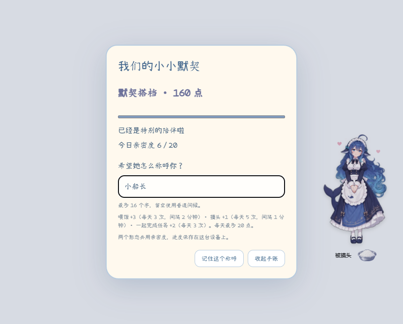

# v1.12.0 · 陪伴手账与双形态回应 / Companion journal and two personalities

鲸鱼娘会逐渐熟悉你了。喂饭、摸头、一起完成任务会增加亲密度，Flash 和 Pro 共用进度，达到新的阶段会解锁更熟悉的回应。

- 点击身体打开转轮，再点击下方的心形进度按钮，打开「陪伴手账」。
- 设置最多 16 个字的专属称呼，她会在问候和互动短句中用上。
- Flash 活泼，Pro 温柔从容。时间问候、摸头、鼓脸、喂饭、吃完和完成任务都有各自的回应。
- 初始为「初次见面」，40 点进入「渐渐熟悉」，160 点进入「默契搭档」。
- 喂饭 +3（每天 3 次，间隔 2 分钟）、摸头 +1（每天 5 次，间隔 1 分钟）、完成任务 +2（每天 3 次），每天最多 20 点。

亲密度和称呼保存在本机，回应使用内置中英文短句。已检查保存与重载、双形态共享、任务重复记录、奖励间隔、每日上限和小窗口显示，并回归检查了问候、求饭、转轮、拖动和变身。

下载附件 **DeepSeekGirl-Harness.zip**，解压后用文件覆盖原插件目录，再退出并重新打开 Harness。[首次安装说明](https://github.com/nailiang002-wq/deepseek-girl-harness/blob/v1.12.0/README.md#三步安装)。

---

Little Whale can now get to know you over time. Feeding, head pats, and completing tasks together earn affection. Flash and Pro share progress and unlock more familiar responses as you reach new stages.

- Open the wheel and select the heart button beneath it to open the companion journal.
- Set a custom name of up to 16 characters for greetings and interaction responses.
- Flash is playful, while Pro is gentle and composed. Each has responses for time greetings, head pats, pouting, feeding, finishing a meal, and completing a task.
- Start at “First meeting,” reach “Getting familiar” at 40 points, and “In sync” at 160.
- Feeding awards 3 points (3/day, 2 minutes apart), head pats 1 point (5/day, 1 minute apart), and completed tasks 2 points (3/day), up to 20 points daily.

Progress and the custom name are saved locally. Responses use built-in Chinese and English text. Checks cover persistence, shared progress, duplicate task records, cooldowns, daily limits, and narrow windows, alongside regression checks for greetings, rice requests, the wheel, dragging, and transformation.

Download **DeepSeekGirl-Harness.zip**, replace the files in your existing plugin folder, then quit and reopen Harness. [Fresh installation guide](https://github.com/nailiang002-wq/deepseek-girl-harness/blob/v1.12.0/README.en.md#install-in-three-steps).
