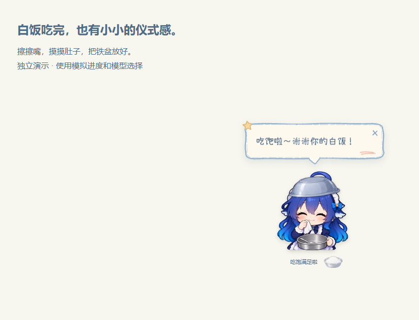

# v1.13.0 · 饭后小动作与升阶回应 / After-meal gestures and affection milestones

吃完白饭后，鲸鱼娘会擦擦嘴、摸摸肚子，再把空铁盆放好。Flash 五套服装与 Pro 三套服装分别新增六张完整人物动作帧，共 48 张，保持头部与站姿对齐。

- **饭后动作**接在连续三口白饭之后，约 3.7 秒，结束后恢复当前任务。
- **连续喂饭**会记住五分钟内的互动，第二盆和第三盆分别使用不同短句，Flash 活泼、Pro 温柔。
- **亲密度新达到 40／160 点**时，出现一次小爱心与专属回应。吃饭、拖动、变身、打开面板或隐藏窗口时会延后提示。
- 系统「减少动态效果」下使用静态人物与升阶提示。

已在 Windows、DSH **0.2.2-rc.5** 上完成兼容检查，并检查八套服装的完整饭后流程、铁盆帽、换装、切换模型、连续喂饭、亲密度升阶、隐藏窗口和减少动态效果。发布包的插件文件与本机测试通过的版本一致。

演示使用模拟进度和模型选择。新增源图与绘制提示词见[饭后动作素材](https://github.com/nailiang002-wq/deepseek-girl-harness/tree/v1.13.0/assets/after-meal)。

下载附件 **DeepSeekGirl-Harness.zip**，解压后用文件覆盖原插件目录，再退出并重新打开 Harness。[首次安装说明](https://github.com/nailiang002-wq/deepseek-girl-harness/blob/v1.13.0/README.md#三步安装)。

---

After finishing her rice, Little Whale wipes her mouth, pats her tummy, and puts down the empty steel basin. Each of the five Flash outfits and three Pro outfits has six new complete character frames, 48 in total, with aligned head and stance anchors.

- After-meal gestures follow the three-bite meal, last about 3.7 seconds, then return to the current task.
- Feeding again within five minutes produces distinct responses for the second and third servings, playful for Flash and gentle for Pro.
- Newly reaching 40 or 160 affection points triggers a one-time heart effect and response. Meals, dragging, transformations, open panels, and hidden windows defer the notice.
- Reduced-motion settings use a still character pose and a static milestone notice.

Compatibility checks passed on Windows with DSH **0.2.2-rc.5**. Checks also cover all eight outfits, the basin hat, wardrobe changes, model changes, repeat feeding, milestone persistence, visibility, and reduced motion. The packaged plugin matches the approved local test build.

Demo images use simulated progress and model selection. [After-meal sources and prompts](https://github.com/nailiang002-wq/deepseek-girl-harness/tree/v1.13.0/assets/after-meal).

Download **DeepSeekGirl-Harness.zip**, replace the files in your existing plugin folder, then quit and reopen Harness. [Fresh installation guide](https://github.com/nailiang002-wq/deepseek-girl-harness/blob/v1.13.0/README.en.md#install-in-three-steps).
